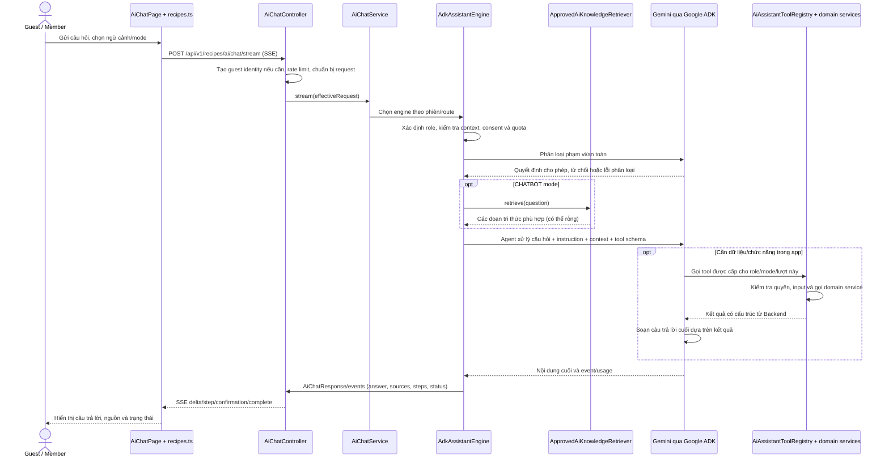

# Báo cáo nghiệp vụ và luồng hoạt động: Trợ lý AI trả lời người dùng Mâm Xanh

- **Ngày đối chiếu mã nguồn:** 21/11/2026
- **Mục đích:** Tài liệu tham khảo để demo và giải thích với giảng viên cách chatbot nhận câu hỏi, tìm thông tin, gọi AI/công cụ và trả kết quả.
- **Loại tài liệu:** Báo cáo đối chiếu yêu cầu SRS với source code hiện tại; không thay thế SRS hoặc OpenAPI.
- **Phạm vi:** Chatbot hỏi đáp ẩm thực chay (FR-51) và các trường hợp AI Assistant điều phối hành động trong app (FR-66). Không trình bày AI tạo thực đơn chuyên biệt FR-34/FR-36 như cùng một nghiệp vụ.

## 1. Tóm tắt để trình bày

Người dùng nhập câu hỏi ở khung chat. Frontend gửi câu hỏi, lịch sử gần nhất, ngữ cảnh trang (chat chung hay một công thức), chế độ thực thi và mã phiên tới Backend qua API streaming. Backend xác định Guest/Member, kiểm tra giới hạn và quyền, gắn dữ liệu công thức công khai đang xem nếu có, rồi chuyển request tới Google ADK agent. Trước lượt trả lời, Backend gọi Gemini để kiểm tra phạm vi/an toàn. Với chế độ chatbot, Backend tìm tài liệu phù hợp trong knowledge base và đưa phần trích dẫn vào ngữ cảnh. Agent Gemini sau đó có thể trả lời trực tiếp hoặc gọi một trong những công cụ Backend được cấp cho lượt đó, ví dụ tìm công thức công khai thật, đọc chi tiết công thức hoặc tra kiến thức đã duyệt. Kết quả công cụ quay lại Gemini để soạn câu trả lời cuối; Backend gửi nội dung và nguồn/steps về giao diện theo SSE.

Khi thao tác có thay đổi dữ liệu, agent không tự ghi tùy ý: Backend áp dụng quyền và kiểm tra nghiệp vụ của công cụ; hành động rủi ro cao sẽ tạo yêu cầu xác nhận chờ người dùng. Các chức năng cần luồng chuyên biệt, như yêu cầu lập thực đơn tuần rõ ràng, có thể được chuyển khỏi chatbot chung. Vì vậy không nên demo rằng mọi câu hỏi đều luôn có cùng số lần gọi Gemini hoặc mọi phản hồi đều bắt buộc truy vấn knowledge base.

**Đây là xác nhận tích hợp ở cấp source code, không phải bằng chứng request Gemini vừa chạy thành công trên máy demo.** Muốn xác nhận runtime phải quan sát log/telemetry của đúng môi trường; báo cáo này không đọc API key, không gọi provider.

## 2. Phân biệt hai nghiệp vụ

| Nghiệp vụ | Mục đích | Ví dụ | Chủ sở hữu logic |
|---|---|---|---|
| Chatbot hỏi đáp FR-51 | Giải thích ẩm thực chay, trả lời theo ngữ cảnh, tìm bài công thức công khai và dùng tri thức nội bộ | “Trứng có phù hợp kiểu vegan không?”, “Tìm món chay dễ nấu” | `AiChatService` + `AdkAssistantEngine`; công cụ truy cập dữ liệu thuộc Backend |
| Assistant điều phối FR-66 | Hiểu yêu cầu và gọi chức năng Mâm Xanh theo quyền/mode; có thể tạo preview, đề xuất mở trang hoặc thực hiện hành động được phép | “Xem lịch ăn tuần này”, “Thêm món vào danh sách mua sắm” | Agent và `AiAssistantToolRegistry`; nghiệp vụ gốc vẫn do service của module tương ứng sở hữu |
| AI lập thực đơn FR-34/FR-36 | Tạo preview thực đơn dựa trên dữ liệu hồ sơ, công thức, kcal và ràng buộc | “Tạo thực đơn tuần” | Luồng AI Menu riêng; không đồng nhất với việc chatbot trả lời một câu hỏi bình thường |

Trong chat chung, một số yêu cầu workflow được Backend chặn/chuyển tới trang hoặc luồng chuyên biệt trước khi vào agent. Hãy xem đây là điều phối ứng dụng; không mặc định câu hỏi ấy đã được Gemini xử lý.

## 3. Luồng chạy từ giao diện tới câu trả lời

### Diễn giải từng bước

1. **Frontend tạo request.** `AiChatPage.send()` gửi câu hỏi, tối đa 8 lượt lịch sử gần nhất (mỗi lượt cắt tối đa 4.000 ký tự), `contextType`, `recipeId` nếu đang ở trang công thức, `sessionId`, `executionMode` và `clientRequestId`. `recipes.ts` mở stream tới `/recipes/ai/chat/stream`, nhận các event và cập nhật nội dung dần.
2. **Controller chuẩn hóa và bảo vệ request.** Với Guest, `AiChatController` lấy anonymous ID và kiểm tra rate limit theo cookie/ID và IP. Với Member, định danh lấy từ Authentication. Controller giữ `no-store`, chuyển request cho `AiChatService` và phát SSE. Backend cũng giới hạn Guest quota token theo tháng và quota thành viên theo gói ở các lớp quota/accounting.
3. **Service chọn đường thực thi.** `AiChatService.answer/stream` ưu tiên hành động điều khiển, phiên đã mở và pilot đủ điều kiện; luồng mặc định hiện nay gọi `AdkAssistantEngine`. Nếu engine không khả dụng trong một số cấu hình/test đặc thù mới có nhánh compatibility `AiAssistantExecutionService`; chế độ `LEGACY` là nhánh cấu hình tương thích, không phải đường mặc định được mô tả cho demo.
4. **Kiểm tra dữ liệu cá nhân và phạm vi.** Engine mở/khôi phục phiên gắn với đúng Guest hoặc tài khoản. Nếu câu hỏi cần dữ liệu hồ sơ cá nhân mà phiên chưa có consent phù hợp, Backend trả `AWAITING_CONSENT` và chưa gửi lượt đó tới Gemini. Engine gọi Gemini classifier qua `AiClient.classifyChatScope`; nếu nội dung ngoài phạm vi hoặc không an toàn, engine trả từ chối. Quota được kiểm tra trước các lời gọi và usage được ghi khi provider trả kết quả có usage.
5. **Lấy kiến thức có căn cứ.** Chỉ với mode `CHATBOT`, engine gọi `ApprovedAiKnowledgeRetriever.retrieve(question)`. Nếu có tài liệu phù hợp thì excerpt được thêm vào prompt và được trả trong `sources`; nếu không có thì danh sách nguồn rỗng, agent vẫn có thể trả lời theo instruction, context công thức và dữ liệu tool. Đây là retrieval từ corpus được duyệt, không phải tìm kiếm Internet.
6. **Agent trả lời hoặc gọi tool.** ADK runner được dựng bằng system instructions, model đã resolve từ cấu hình/preference, và danh sách tool giới hạn theo actor, mode và ngữ cảnh. Chatbot thuần (`CHATBOT`) không được gắn domain tools trong `scopedDefinitions`; mode điều phối mới có tool. Gemini chọn tool nếu cần. Backend thực thi tool thật qua registry/domain services rồi gửi tool result về agent. Một lượt bị chặn tối đa 6 lần gọi LLM và các tool chạy tuần tự.
7. **Trả kết quả và xác nhận.** Engine trích câu trả lời cuối, kiểm tra lại nội dung theo run status/steps, đóng gói nguồn và kết quả tool. Nếu tool yêu cầu xác nhận, trả `AWAITING_CONFIRMATION` kèm confirmation ID; thao tác chỉ tiếp tục khi người dùng quyết định hợp lệ. Các patch biểu mẫu chuyên gia cần Frontend áp dụng/acknowledge revision. Giao diện nhận delta, step, confirmation và event hoàn tất.

## 4. Trợ lý dựa vào dữ liệu nào?

- **Câu hỏi và hội thoại:** prompt hiện tại cộng các turn history do Frontend gửi; lịch sử client lấy tối đa 8 lượt hiển thị gần nhất. Không nên suy ra rằng toàn bộ lịch sử tài khoản được truy vấn.
- **Ngữ cảnh công thức:** nếu chat được mở từ Recipe Detail, Backend tải Recipe Post công khai theo ID và đưa thông tin thật (tiêu đề, nguyên liệu, hướng dẫn, nutrition khả dụng) vào context; không tin dữ liệu recipe tùy ý do model tự khai.
- **Knowledge base:** `knowledge-base/index.json` cùng tài liệu được duyệt được truy hồi qua `ApprovedAiKnowledgeRetriever`. Trích đoạn được gắn vào prompt và nguồn được đưa về response. Không tìm Internet.
- **Dữ liệu người dùng:** hồ sơ, tùy chọn ăn chay/dị ứng, lịch ăn, shopping list và dữ liệu riêng chỉ có thể đọc qua công cụ/domain service được đăng ký; cần role, ownership và consent phù hợp. Guest không có hồ sơ dinh dưỡng tài khoản.
- **Công thức gợi ý:** khi tool `search_public_recipes` được dùng, Backend truy vấn Recipe Post hiện hành và trả ID thật. UI card/recommendation phải dựa vào kết quả thật của Backend; Gemini không được bịa bài đăng để thay thế kết quả rỗng.
- **Lưu ý chất lượng retrieval:** nếu index knowledge thiếu, lỗi hoặc lệch corpus/config, retriever có nhánh keyword/degraded hoặc trả ít/không có nguồn theo cơ chế hiện tại. Retrieval source rỗng không chứng minh Gemini bị giả lập; nó chỉ có nghĩa lượt đó không nhận được đoạn knowledge phù hợp.

## 5. Gemini được gọi thế nào? Có phải app giả bộ không?

Trong cấu hình hiện tại, `AdkAssistantEngine` tạo ADK agent với `AdkModelGateway`, còn `AdkConfiguration` tạo `Gemini` khi `GEMINI_API_KEY` có giá trị. Khi key rỗng, code dùng `UnconfiguredLlm`, phát lỗi provider “Gemini is not configured”; không có fallback tạo câu trả lời chatbot giả. `AiChatService` cũng có nhánh legacy/direct `answerChat`, nhưng nhánh này cần cấu hình LEGACY và không phải đường mặc định ADK.

Một câu hỏi có thể phát sinh nhiều lần gọi Gemini: classifier trước, rồi agent generation; nếu model gọi tool thì còn tool-result continuation. Quota/accounting và `MAX_LLM_CALLS=6` áp dụng ở các điểm tương ứng. Không khẳng định chính xác chi phí hoặc số lần gọi của một câu cụ thể khi chưa có telemetry của lần chạy đó.

Các nhánh có thể trả lời mà không gọi Gemini gồm: validation/context bị từ chối trước provider; yêu cầu chuyển sang workflow chuyên biệt; lỗi quota/consent; hủy phiên; Gemini không cấu hình hoặc không sẵn sàng. Do đó phản hồi 200/UI có nội dung tự nó chưa chứng minh một request Gemini thành công.

## 6. Bảng chứng cứ: hàm, file và vị trí trong code

| Nội dung cần chứng minh | Hàm/file/vị trí | Ý nghĩa khi demo |
|---|---|---|
| API chat và phạm vi guest/member | [`AiChatController.answer()` — AiChatController.java, dòng 77](../../app/mamxanh-backend/src/main/java/tech/mamxanh/recipe/controller/AiChatController.java#L77), [`prepareEffectiveRequest()` — dòng 105](../../app/mamxanh-backend/src/main/java/tech/mamxanh/recipe/controller/AiChatController.java#L105) | Endpoint `POST /api/v1/recipes/ai/chat`; mô tả quota, context, guest không có profile và workflow đặc biệt. |
| Stream thực thời gian | [`stream()` — AiChatController.java, dòng 122](../../app/mamxanh-backend/src/main/java/tech/mamxanh/recipe/controller/AiChatController.java#L122) | Backend phát SSE event; client có thể dừng stream. |
| Frontend gửi câu hỏi + history | [`send()` — AiChatPage.tsx, dòng 535](../../app/mamxanh-frontend/src/pages/AiChatPage.tsx#L535), request tại [dòng 605](../../app/mamxanh-frontend/src/pages/AiChatPage.tsx#L605) | Có context/mode/session và tối đa 8 turn gần nhất. |
| Frontend mở stream và đọc delta/step | [`streamAiChat()` — recipes.ts, dòng 380](../../app/mamxanh-frontend/src/api/recipes.ts#L380), fetch ở [dòng 407](../../app/mamxanh-frontend/src/api/recipes.ts#L407) | Kết nối đúng endpoint stream; parse event để cập nhật UI. |
| Chọn engine/phiên/pilot | [`answer()` — AiChatService.java, dòng 141](../../app/mamxanh-backend/src/main/java/tech/mamxanh/recipe/service/AiChatService.java#L141) | Phiên sở hữu được giữ affinity; sau đó chọn pilot hoặc ADK engine. |
| Mở phiên, consent, classifier, retrieval | [`execute()` — AdkAssistantEngine.java, dòng 196](../../app/mamxanh-backend/src/main/java/tech/mamxanh/recipe/service/AdkAssistantEngine.java#L196); classifier ở [dòng 649](../../app/mamxanh-backend/src/main/java/tech/mamxanh/recipe/service/AdkAssistantEngine.java#L649) | Chỉ dẫn thứ tự kiểm tra trước agent; knowledge retrieval ở dòng 294–307. |
| Cách lắp agent, instruction, model và tools | [`ensureRunner()` — AdkAssistantEngine.java, dòng 1460](../../app/mamxanh-backend/src/main/java/tech/mamxanh/recipe/service/AdkAssistantEngine.java#L1460) | Chatbot thuần không có domain tools; mode điều phối được giới hạn tool theo role/mode. |
| Agent loop và giới hạn gọi | [`runAdkTurn()` — AdkAssistantEngine.java, dòng 422](../../app/mamxanh-backend/src/main/java/tech/mamxanh/recipe/service/AdkAssistantEngine.java#L422), runner ở [dòng 466](../../app/mamxanh-backend/src/main/java/tech/mamxanh/recipe/service/AdkAssistantEngine.java#L466) | ADK chạy model và tool tuần tự, tối đa 6 LLM calls/turn. |
| Danh mục tool và risk level | [`definitionsFor()` — AiAssistantToolRegistry.java, dòng 94](../../app/mamxanh-backend/src/main/java/tech/mamxanh/recipe/service/AiAssistantToolRegistry.java#L94), dispatch tại [dòng 142](../../app/mamxanh-backend/src/main/java/tech/mamxanh/recipe/service/AiAssistantToolRegistry.java#L142) | Registry chỉ định tool và risk; dispatch gọi service ứng dụng thật. |
| Tìm recipe và knowledge | [`searchRecipes()` / `searchKnowledge()` — AiAssistantToolRegistry.java, dòng 205](../../app/mamxanh-backend/src/main/java/tech/mamxanh/recipe/service/AiAssistantToolRegistry.java#L205) | Recipe search lấy dữ liệu công khai; knowledge search không tìm Internet. |
| Chỉ dẫn hội thoại | [`system.md`](../../app/mamxanh-backend/src/main/resources/ai/prompts/system.md), [`agent-instructions.md`](../../app/mamxanh-backend/src/main/resources/ai/prompts/agent-instructions.md), [`classifier.md`](../../app/mamxanh-backend/src/main/resources/ai/prompts/classifier.md) | Nội dung hướng dẫn hành vi và phân loại nạp bởi `AiChatPromptLoader`. |
| Gemini cấu hình thật hay lỗi rõ | [`AdkConfiguration.createLlm()` — AdkConfiguration.java, dòng 64](../../app/mamxanh-backend/src/main/java/tech/mamxanh/integration/ai/adk/AdkConfiguration.java#L64) | Có key mới tạo `Gemini`; không key thì `UnconfiguredLlm` trả lỗi provider. |
| SRS hỏi đáp theo ngữ cảnh | [FR-51 — FUNCTIONAL-REQUIREMENTS.md, dòng 3321](../requirements/srs/FUNCTIONAL-REQUIREMENTS.md#fr-51) | Nguồn yêu cầu nghiệp vụ chatbot. |
| SRS điều phối có quyền/mode | [FR-66 — FUNCTIONAL-REQUIREMENTS.md, dòng 4045](../requirements/srs/FUNCTIONAL-REQUIREMENTS.md#fr-66) | AI không được vượt quyền chức năng gốc; xác nhận thao tác rủi ro. |
| Quy tắc không giả bài đăng | [BR-38 — BUSINESS-RULES.md, dòng 323](../requirements/srs/BUSINESS-RULES.md#br-38) | Ưu tiên bài công khai thật; nội dung soạn mới chỉ khi người dùng yêu cầu rõ, và chỉ là bản nháp chat. |

> Số dòng là vị trí tại thời điểm đối chiếu; sau khi code thay đổi, tìm theo tên hàm nếu link dòng lệch.

## 7. Demo ngắn với giảng viên

1. Hỏi một câu kiến thức, ví dụ: **“Trứng gà có phù hợp chế độ vegan không?”** Giải thích chatbot sẽ phân loại phạm vi, tìm knowledge nếu có đoạn phù hợp rồi trả lời; câu trả lời phụ thuộc dữ liệu, instruction và model.
2. Hỏi: **“Tìm giúp tôi công thức chay dễ nấu có đậu hũ.”** Chỉ ra agent có thể gọi `search_public_recipes`; thẻ kết quả phải có ID/bài công thức đang công khai do Backend trả về.
3. Nếu có sẵn demo đăng nhập, hỏi đọc lịch ăn hoặc thêm món vào shopping list trong mode tương ứng. Cho thấy tool step/preview; với hành động yêu cầu xác nhận thì chỉ bấm xác nhận sau khi review nội dung.
4. Mở source bằng các link trong bảng để trình bày tuyến `AiChatPage.send()` → Controller → `AiChatService.answer()` → `AdkAssistantEngine.execute()` → ADK runner → tool/result → SSE response.

Không dùng một lần chạy UI đơn lẻ để tuyên bố Gemini API đã được gọi thật. Bằng chứng runtime phù hợp là log/telemetry cùng request ID/usage của môi trường demo, đã loại bỏ prompt/raw content và thông tin nhạy cảm.

## 8. Giới hạn và cách trả lời câu hỏi thường gặp

- **“AI tự biết dữ liệu app ở đâu?”** Model không đọc database trực tiếp. Nó chỉ nhận context do Backend dựng và kết quả tool mà Backend cho phép.
- **“Có gọi Gemini thật không?”** Source tích hợp Gemini thật qua ADK khi key được cấu hình; thiếu key thì provider lỗi, không có chatbot giả. Nhưng phải kiểm tra runtime/log của đúng máy để chứng minh lần demo cụ thể đã gọi thành công.
- **“AI có thể tự tạo công thức rồi giả là món có trên app không?”** Theo BR-38, không. Tìm món phải dùng Recipe Post công khai thật; soạn mới/biến tấu chỉ khi user yêu cầu, nội dung chỉ ở chat.
- **“AI có tự ý sửa dữ liệu không?”** Không theo đường thông thường. Tool bị giới hạn theo role/mode và Backend vẫn kiểm tra quyền/validation. Thao tác có rủi ro cao cần confirmation; quyền AI không cấp quyền nghiệp vụ mới.
- **“Mọi câu trả lời đều lấy từ knowledge base à?”** Không. Retrieval chỉ chạy trong `CHATBOT` mode và có thể không tìm thấy excerpt; trong mode khác agent chủ yếu dựa trên instruction, context và công cụ được cấp.
- **“Chat có lưu lịch sử dài hạn không?”** SRS quy định phiên tạm thời/không đồng bộ lịch sử dài hạn theo tài khoản; request hiện gửi history hữu hạn từ client. Xem FR-51/NFR-22 để trình bày chi tiết chính sách lưu trữ.

## 9. Trạng thái kiểm chứng

Báo cáo được đối chiếu tĩnh với SRS FR-02/FR-51/FR-66, BR-38, OpenAPI snapshot, Frontend `AiChatPage`/`recipes.ts` và Backend controller/service/ADK/tool/config. Trong lượt lập báo cáo không khởi động hệ thống, không gửi HTTP request, không gọi Gemini, không kiểm tra key môi trường, không kiểm thử tài khoản thật và không chạy test. Kết luận “tích hợp Gemini thật” chỉ xác nhận từ đường code cấu hình; trạng thái runtime ở máy demo cần chứng cứ riêng.
