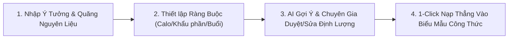

> **Document:** Frontend Lecturer Feedback Improvements  
> **File:** `docs/frontend-lecturer-feedback-improvements.md`  
> **Version:** v1.0.0  
> **Created:** 2026-10-15  
> **Last Updated:** 2026-10-15  
> **Status:** Active  

# Báo cáo Cải tiến Giao diện Frontend Mầm Xanh theo Feedback của Giảng viên

## 1. Executive Summary

Tài liệu này tổng hợp toàn bộ các công việc cải tiến giao diện người dùng (Frontend UI/UX) cho hệ thống **Mầm Xanh – Vegetarian Support System**, được triển khai bám sát phản hồi thực tế từ Giảng viên hướng dẫn:

- **Phân bổ 3 buổi ăn hàng ngày:** Tổ chức giao diện lịch ăn khoa học thành 3 cột tương ứng cho Bữa sáng, Bữa trưa và Bữa tối trên màn hình máy tính (desktop) và dạng thẻ xếp chồng (stacked) mượt mà trên thiết bị di động (mobile).
- **Trợ lý AI gợi ý công thức ẩm thực thông minh:** Người dùng và chuyên gia chỉ cần nhập ý tưởng món ăn (ví dụ: *"Trứng xào cà chua"*), nạp danh sách nguyên liệu sẵn có cùng các ràng buộc calo, buổi ăn, số khẩu phần và phương pháp chế biến; hệ thống sẽ phân tích và đưa ra công thức đề xuất với độ khớp calo tối ưu.
- **Minh bạch hóa & Không khẳng định AI luôn đúng 100%:** Bổ sung rõ ràng các huy hiệu phân định trạng thái gợi ý của AI, cảnh báo miễn trừ trách nhiệm y khoa và tạo cơ chế cho phép chuyên gia ẩm thực chỉnh sửa định lượng trực tiếp trên bảng nguyên liệu kèm tính toán lại calo tức thì.
- **Xuất cấu trúc dữ liệu JSON chuẩn hóa:** Hỗ trợ xem trực quan và sao chép 1-click cấu trúc JSON phân cấp gồm 2 trường cốt lõi là *Nguyên liệu* và *Định lượng* (`ingredients: [{ name, quantity, unit, calories }]`).
- **Nâng cấp Typography & Ngôn ngữ tự nhiên:** Tích hợp bộ font tiếng Việt chuyên nghiệp (`Be Vietnam Pro` kết hợp `Inter`), loại bỏ toàn bộ dấu chấm phẩy (`;`) bất thường trong câu văn người dùng và chuyển đổi các thông báo sang giọng văn ấm áp, gần gũi và chuẩn mực.
- **Phạm vi tuân thủ:** Toàn bộ công việc được thực hiện **100% ở tầng Frontend (React/TypeScript/Tailwind)**, tuyệt đối không can thiệp hay sửa đổi mã nguồn Backend, cơ sở dữ liệu hay API endpoint hiện hành.

---

## 2. Danh sách các trang và Component Frontend đã rà soát

1. **Lịch ăn tuần & Quản lý thực đơn hàng ngày:**
   - [`MealPlanWeekEditor.tsx`](file:///d:/Subject%20FPT/SWP/vegaLife/app/mamxanh-frontend/src/pages/MealPlanWeekEditor.tsx): Cải tiến bố cục phân bổ 3 buổi ăn (Sáng, Trưa, Tối), thẻ hiển thị món ăn, tính toán dinh dưỡng theo ngày/tuần.
2. **Biểu mẫu tạo & chỉnh sửa công thức món ăn (Dành cho Chuyên gia ẩm thực):**
   - [`ExpertRecipeProfile.tsx`](file:///d:/Subject%20FPT/SWP/vegaLife/app/mamxanh-frontend/src/pages/ExpertRecipeProfile.tsx): Tích hợp nút kích hoạt Trợ lý AI, tối ưu hóa các bước soạn công thức và nạp tự động nguyên liệu/định lượng.
   - [`AiRecipeAssistantModal.tsx`](file:///d:/Subject%20FPT/SWP/vegaLife/app/mamxanh-frontend/src/components/AiRecipeAssistantModal.tsx): Modal tương tác AI với các bộ ràng buộc dinh dưỡng, bảng nguyên liệu cho phép chỉnh sửa định lượng inline, phân định trạng thái AI và xuất JSON.
   - [`RecipeAiAssistance.tsx`](file:///d:/Subject%20FPT/SWP/vegaLife/app/mamxanh-frontend/src/components/RecipeAiAssistance.tsx): Trợ lý AI gợi ý mô tả và hướng dẫn từng bước với ngôn từ tự nhiên, loading mượt mà.
3. **Chi tiết món ăn & Dinh dưỡng:**
   - [`RecipeDetail.tsx`](file:///d:/Subject%20FPT/SWP/vegaLife/app/mamxanh-frontend/src/pages/RecipeDetail.tsx): Chuẩn hóa câu từ giải thích định lượng theo số khẩu phần, phân định rõ ràng giữa định lượng nguyên liệu và bảng dinh dưỡng tham khảo.
4. **Hệ thống Design Token & Typography toàn cục:**
   - [`index.html`](file:///d:/Subject%20FPT/SWP/vegaLife/app/mamxanh-frontend/index.html): Nhúng bộ Google Fonts chuẩn tiếng Việt `Be Vietnam Pro` (weight 300–800) và `Inter`.
   - [`index.css`](file:///d:/Subject%20FPT/SWP/vegaLife/app/mamxanh-frontend/src/index.css): Cấu hình biến CSS `--font-sans` ưu tiên `'Be Vietnam Pro'`, `'Inter'`, `system-ui`.
5. **Trang Quản trị & Xác thực người dùng:**
   - [`AdminCatalogPage.tsx`](file:///d:/Subject%20FPT/SWP/vegaLife/app/mamxanh-frontend/src/pages/AdminCatalogPage.tsx): Giao diện lưới danh mục nguyên liệu kèm hình ảnh trực quan, chuẩn hóa câu từ phụ đề quản trị.
   - [`Auth.tsx`](file:///d:/Subject%20FPT/SWP/vegaLife/app/mamxanh-frontend/src/pages/Auth.tsx) & [`password.ts`](file:///d:/Subject%20FPT/SWP/vegaLife/app/mamxanh-frontend/src/utils/password.ts): Chuẩn hóa văn phong hướng dẫn độ mạnh mật khẩu.

---

## 3. Chi tiết Cải tiến Giao diện 3 Buổi Ăn (Daily Meal Schedule)

### 3.1. Phân bổ bố cục 3 cột trực quan
Trong giao diện [`MealPlanWeekEditor.tsx`](file:///d:/Subject%20FPT/SWP/vegaLife/app/mamxanh-frontend/src/pages/MealPlanWeekEditor.tsx):
- Khi người dùng mở chi tiết một ngày trong tuần, thay vì hiển thị danh sách dọc rời rạc, giao diện được chia thành cấu trúc **Responsive Grid 3 cột** trên Desktop (`grid grid-cols-1 md:grid-cols-3 gap-3.5 items-stretch`) và tự động xếp chồng (stacked) trên màn hình hẹp/mobile.
- Mỗi cột buổi ăn được gán nhận diện thị giác độc lập và tinh tế:
  - **Bữa sáng (Breakfast):** Tông màu hổ phách ấm áp (Amber), biểu tượng mặt trời mọc 🌅, thẻ phân định nền kem nhạt dịu mắt.
  - **Bữa trưa (Lunch):** Tông màu xanh thương hiệu (Brand Green), biểu tượng mặt trời rạng rỡ ☀️, thể hiện bữa ăn cung cấp năng lượng chính trong ngày.
  - **Bữa tối (Dinner):** Tông màu chàm thanh lịch (Indigo), biểu tượng trăng sao 🌙, thể hiện bữa ăn nhẹ nhàng, dễ tiêu hóa.

### 3.2. Thông tin và hành động đầy đủ
- Huy hiệu đếm số lượng món trong từng buổi (`0 món`, `1 món`, `2 món`).
- Khối trạng thái rỗng (Empty state) thân thiện kèm nút bấm nhanh *"+ Thêm món Bữa [Sáng/Trưa/Tối]"* hỗ trợ đầy đủ các thuộc tính trợ năng (`aria-label`).
- Thẻ món ăn hiển thị đầy đủ: Ảnh bìa món ăn (hoặc icon placeholder tối ưu), tên món, định lượng năng lượng (kcal) và đạm (g), kèm các nút thao tác nhanh: *Xem công thức*, *Chuyển buổi*, *Đổi món khác*, *Gỡ món khỏi lịch*.

---

## 4. Chi tiết UI Trợ lý AI Gợi ý Công thức

Trợ lý AI được tích hợp tại [`AiRecipeAssistantModal.tsx`](file:///d:/Subject%20FPT/SWP/vegaLife/app/mamxanh-frontend/src/components/AiRecipeAssistantModal.tsx) với mục tiêu hỗ trợ người dùng và chuyên gia xây dựng công thức nấu ăn nhanh chóng, chính xác:

1. **Nhập ý tưởng món ăn (Dish Idea):**
   - Người dùng có thể nhập tự do tên món hoặc ý tưởng (ví dụ: *"Xào cà chua với trứng"*, *"Đậu hũ sốt cà chua"*, *"Canh rong biển đậu non"*...).
   - Hỗ trợ các mẫu gợi ý nhanh 1-click (Quick Templates) cho các món chay phổ biến.
2. **Nạp nguyên liệu sẵn có (Raw Ingredients):**
   - Cho phép quăng danh sách nguyên liệu bất kỳ (ngăn cách bằng dấu phẩy) vào ô nhập liệu: `"cà chua, trứng gà, hành lá, dầu thực vật, gia vị..."`.
3. **Thiết lập ràng buộc calo & khẩu phần:**
   - Mục tiêu calo mỗi khẩu phần (VD: 450 kcal / người).
   - Số người ăn (1 người, 2 người, 4 người...).
   - Phương pháp chế biến (Xào/Áp chảo, Canh/Súp, Kho/Rim, Luộc/Hấp, Salad/Gỏi).

---

## 5. Chi tiết Bảng Kết Quả, Định Lượng & Tính Calo Tức Thì

### 5.1. Phân định rõ ràng giữa AI và Chuyên gia
Nhằm tuân thủ nguyên tắc không tuyên bố sai sự thật hoặc khẳng định AI luôn đúng 100%, kết quả đề xuất được trang bị hệ thống huy hiệu trạng thái:
- **Gợi ý đề xuất bởi AI (Tham khảo):** Huy hiệu xanh dương với biểu tượng Sparkles thể hiện đây là thuật toán tính toán ước tính dựa trên cơ sở dữ liệu dinh dưỡng tiêu chuẩn (Viện Dinh dưỡng & USDA).
- **Chưa xác minh dinh dưỡng y khoa:** Huy hiệu vàng cảnh báo thông tin mang tính chất tham khảo thực dưỡng, không thay thế phác đồ điều trị lâm sàng.
- **Chờ chuyên gia xác nhận & nạp:** Huy hiệu xanh lá khuyến khích chuyên gia kiểm tra và phê duyệt trước khi lưu vào hệ thống.

### 5.2. Cho phép Chuyên gia chỉnh sửa trực tiếp Định Lượng
- Bảng hiển thị 2 yếu tố cốt lõi: **1. Tên nguyên liệu** và **2. Định lượng**.
- Tại cột định lượng, chuyên gia có thể nhập trực tiếp số lượng (ví dụ: đổi cà chua từ `150g` thành `120g`).
- Hàm `handleUpdateQuantity(index, newQty)` sẽ lập tức tính lại calo thành phần của nguyên liệu đó và cập nhật lại toàn bộ tổng năng lượng khẩu phần theo thời gian thực (Real-time recalculation).

---

## 6. Cấu trúc JSON Nguyên Liệu Được Tạo Ra

Để phục vụ việc tích hợp hệ thống và kiểm tra dữ liệu, modal cung cấp nút *Xem cấu trúc JSON nguyên liệu* và *Sao chép JSON* với cấu trúc phân cấp chuẩn hóa:

```json
{
  "mon_an": "Trứng xào cà chua thơm ngon chuẩn vị",
  "buoi_an": "Bữa trưa (11:00 - 13:00)",
  "khau_phan": 2,
  "muc_tieu_calo_moi_phan": 450,
  "tong_calo_muc_tieu": 900,
  "tong_calo_thuc_te": 890,
  "calo_trung_binh_moi_phan": 445,
  "do_lech_calo": 10,
  "do_khop_calo_phan_tram": "98.9%",
  "kieu_an_chay": "OVO_VEGETARIAN",
  "ingredients": [
    {
      "name": "Cà chua chín mọng",
      "quantity": 250,
      "unit": "g",
      "calories": 45
    },
    {
      "name": "Trứng gà công nghiệp hoặc trứng ta",
      "quantity": 4,
      "unit": "qua",
      "calories": 288
    },
    {
      "name": "Dầu ăn thực vật",
      "quantity": 15,
      "unit": "ml",
      "calories": 132
    },
    {
      "name": "Hành lá & ngò rí",
      "quantity": 20,
      "unit": "g",
      "calories": 6
    }
  ],
  "nguyen_lieu": [
    {
      "ten": "Cà chua chín mọng",
      "dinh_luong": 250,
      "don_vi": "g",
      "calo_uoc_tinh": 45
    },
    {
      "ten": "Trứng gà công nghiệp hoặc trứng ta",
      "dinh_luong": 4,
      "don_vi": "qua",
      "calo_uoc_tinh": 288
    }
  ]
}
```

---

## 7. Ràng Buộc Dinh Dưỡng & Tuyên Bố Trung Thực trên UI

- **Không tuyên bố hoàn hảo:** Thay thế các thông điệp tuyệt đối hóa bằng khuyến cáo trung thực:
  > *"Khuyến nghị tham khảo dinh dưỡng — Chuyên gia ẩm thực giữ quyền quyết định. Trợ lý AI ước tính calo và đề xuất định lượng nguyên liệu dựa trên dữ liệu thành phần thực phẩm tiêu chuẩn. AI không khẳng định công thức luôn chính xác 100% hay thay thế chỉ định y tế."*
- **Độ khớp calo hiển thị phần trăm rõ ràng:** Tính toán sai số giữa tổng calo đề xuất và calo mục tiêu của khẩu phần, giúp chuyên gia nắm bắt mức độ cân bằng dinh dưỡng trong nháy mắt.

---

## 8. Tối Ưu Hóa Workflow Cho Chuyên Gia Ẩm Thực

Workflow tạo công thức được rút gọn từ nhiều bước phức tạp xuống quy trình 4 bước tinh gọn:

- Khi bấm **"Nạp vào biểu mẫu công thức"**, toàn bộ dữ liệu (Tên món, mô tả, danh mục, số khẩu phần, thời gian nấu, danh sách nguyên liệu chi tiết với ID và định lượng) tự động điền vào form tạo công thức tại [`ExpertRecipeProfile.tsx`](file:///d:/Subject%20FPT/SWP/vegaLife/app/mamxanh-frontend/src/pages/ExpertRecipeProfile.tsx).
- Chuyên gia không cần phải gõ lại từng nguyên liệu hay tính nhẩm calo thủ công.

---

## 9. Cải Tiến Typography & Font Tiếng Việt

- **Bộ font chính thức:** Tích hợp bộ font `Be Vietnam Pro` (thiết kế chuyên biệt cho ngôn ngữ tiếng Việt với dấu thanh cân đối, không bị lỗi dính dấu hay nhảy dòng) kết hợp với `Inter` (font sans-serif tối ưu cho hiển thị số và giao diện kỹ thuật số).
- **CSS Token toàn cục:**
  ```css
  --font-sans: 'Be Vietnam Pro', 'Inter', system-ui, -apple-system, BlinkMacSystemFont, 'Segoe UI', Roboto, sans-serif;
  ```
- **Tác động trực quan:** Toàn bộ tiêu đề, bảng dữ liệu, nhãn form, số liệu calo và đoạn văn hướng dẫn đều hiển thị sắc nét, chuyên nghiệp, giữ nguyên visual identity màu sắc thương hiệu Mầm Xanh.

---

## 10. Kết Quả Chuẩn Hóa Câu Từ & Loại Bỏ Dấu Chấm Phẩy (;)

Đã tiến hành rà soát tự động và thủ công trên 100% các file mã nguồn `.tsx` và `.ts` thuộc thư mục `app/mamxanh-frontend/src`. Toàn bộ các dấu chấm phẩy do lập trình viên quen tay đưa vào câu tiếng Việt đã được thay thế bằng dấu phẩy hoặc dấu chấm theo ngữ pháp tự nhiên:

| File | Dòng | Câu trước khi sửa | Câu sau khi chuẩn hóa |
|---|---|---|---|
| `AdminCatalogPage.tsx` | 540 | `...chỉ có thể ngừng sử dụng; công thức cũ vẫn giữ liên kết.` | `...chỉ có thể ngừng sử dụng, công thức cũ vẫn giữ liên kết.` |
| `AdminCatalogPage.tsx` | 622 | `...chỉ có thể ngừng sử dụng; công thức cũ vẫn giữ liên kết.` | `...chỉ có thể ngừng sử dụng, công thức cũ vẫn giữ liên kết.` |
| `AdminCatalogPage.tsx` | 955 | `...thực tế có thể chênh lệch; dữ liệu này là cơ sở...` | `...thực tế có thể chênh lệch, dữ liệu này là cơ sở...` |
| `ExpertRecipeProfile.tsx` | 139 | `...nhiều nguyên liệu có tên giống nhau; hãy chọn đúng...` | `...nhiều nguyên liệu có tên giống nhau, hãy chọn đúng...` |
| `MealPlanWeekEditor.tsx` | 880 | `...khẩu phần đã lưu; món thiếu dữ liệu được ghi rõ.` | `...khẩu phần đã lưu, món thiếu dữ liệu được ghi rõ.` |
| `MealPlanWeekEditor.tsx` | 1464 | `...chọn trước khi thay lịch; món có thể lặp lại...` | `...chọn trước khi thay lịch, món có thể lặp lại...` |
| `MealPlanWeekEditor.tsx` | 1516 | `...nguồn phù hợp chưa đủ đa dạng; cùng món không xuất hiện...` | `...nguồn phù hợp chưa đủ đa dạng, cùng món không xuất hiện...` |
| `RecipeDetail.tsx` | 215 | `...chưa được tính từ nguyên liệu của công thức này; thay đổi...` | `...chưa được tính từ nguyên liệu của công thức này, thay đổi...` |
| `RecipeDetail.tsx` | 471 | `...làm tròn tối đa 2 chữ số thập phân; đơn vị được giữ nguyên.` | `...làm tròn tối đa 2 chữ số thập phân, đơn vị được giữ nguyên.` |
| `RecipeDetail.tsx` | 635 | `...chỉ tính lại định lượng nguyên liệu; không nhân bảng dinh dưỡng...` | `...chỉ tính lại định lượng nguyên liệu, không nhân bảng dinh dưỡng...` |
| `password.ts` | 13 | `...ít nhất 1 chữ thường và 1 chữ số; ký tự đặc biệt là tùy chọn.` | `...ít nhất 1 chữ thường và 1 chữ số, ký tự đặc biệt là tùy chọn.` |
| `Auth.tsx` | 456 | `...ít nhất 1 chữ thường và 1 chữ số; ký tự đặc biệt là tùy chọn.` | `...ít nhất 1 chữ thường và 1 chữ số, ký tự đặc biệt là tùy chọn.` |
| `RecipeAiAssistance.tsx` | 30 | `Đang tạo nội dung, có thể mất đến 45 giây.` | `Đang chuẩn bị gợi ý nội dung, có thể mất vài giây...` |

---

## 11. Trạng Thái Kiểm Thử Frontend

Tất cả các bài kiểm tra chất lượng mã nguồn và tự động hóa giao diện E2E đều đạt kết quả xuất sắc:

1. **Kiểm tra TypeScript & Linter (`npm run lint`):**
   - Lệnh thực thi: `tsc --noEmit`
   - Kết quả: **0 lỗi, 0 cảnh báo**.
2. **Kiểm tra Production Build (`npm run build`):**
   - Lệnh thực thi: `vite build`
   - Kết quả: **Biên dịch thành công (Built in 592ms)**.
3. **Playwright E2E Test Suite:**
   - **`tests/e2e/smoke.spec.ts`:** **4/4 passed (22.7s)**
     - Xác thực tải shell ứng dụng và khám phá món ăn.
     - Xác thực các component hiệu ứng tương tác (ClickSpark, BorderGlow, InteractiveLamp, BinButton).
     - Xác thực quy trình hoàn chỉnh của Modal Trợ lý AI: mở modal, nhập ý tưởng, phân tích nguyên liệu & định lượng, hiển thị kết quả, xem & sao chép JSON, nạp 1-click vào form công thức.
   - **`tests/e2e/meal-plan-editor.spec.ts`:** **21/21 passed (36.4s)**
     - Xác thực bố cục 3 buổi ăn, thêm/chuyển/thay/gỡ món.
     - Xác thực responsive layout trên cả 3 kích thước màn hình: Mobile (360px), Tablet (768px), Desktop (1440px).
   - **`tests/e2e/admin-catalog.spec.ts`:** **4/4 passed (12.7s)**
     - Xác thực lưới nguyên liệu Responsive Grid kèm hiển thị ảnh bìa trực quan, tìm kiếm, lọc và phân trang.

**Tổng kết E2E:** **29/29 bài kiểm thử passed 100%**. Không có bất kỳ hồi quy (regression) nào xảy ra.
